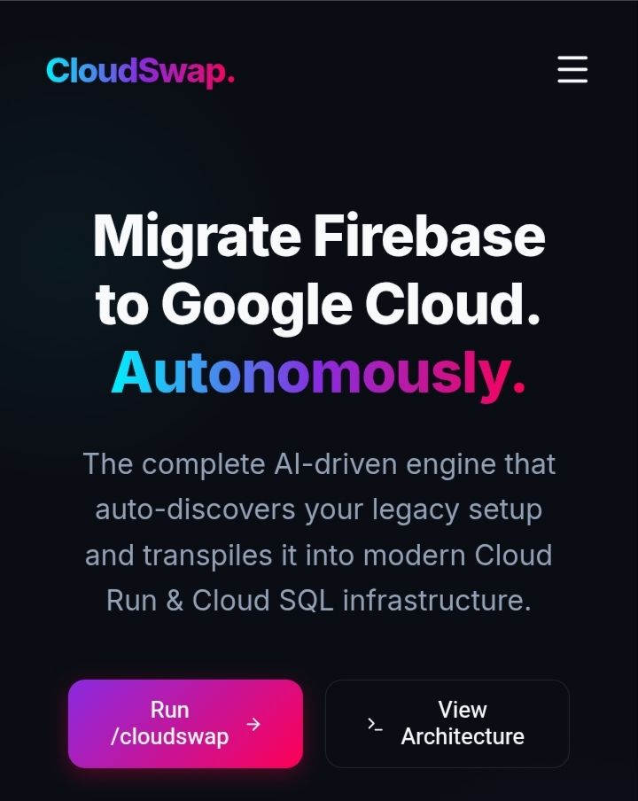
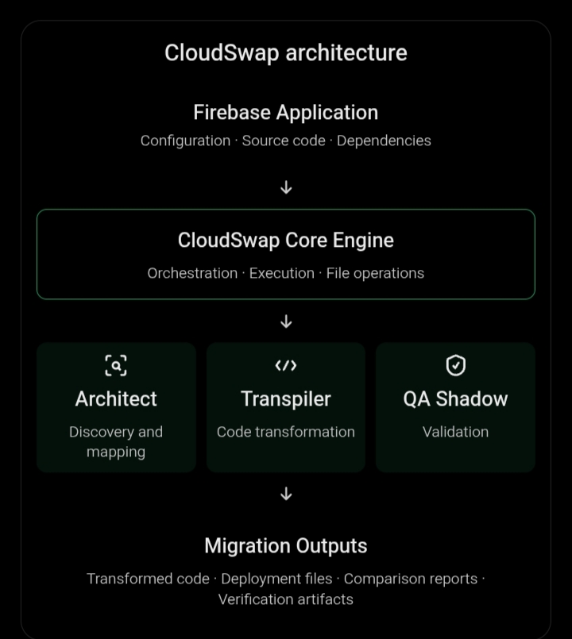

# CloudSwap 🚀

**Autonomous Firebase-to-Google Cloud Migration Agent**

CloudSwap is an autonomous migration pipeline designed to transition existing Firebase projects to Google Cloud infrastructure, with a focus on Google Cloud Run and Cloud SQL.

Migrating a Firebase application involves more than replacing SDK imports. It can require analysing existing services, translating Firestore data models and queries, restructuring backend functions, preparing deployment infrastructure, and verifying that migrated endpoints preserve the behaviour of the original application.




CloudSwap automates these migration stages through a coordinated system of specialised agents, reducing the manual effort involved in moving Firebase applications towards an enterprise-grade Google Cloud architecture.

## Overview

CloudSwap acts as an intelligent migration assistant that analyses an existing Firebase project, plans the migration, transforms application code and database integrations, and validates the resulting implementation.

The migration pipeline is powered by three specialised agents:

- **The Architect:** Analyses the existing Firebase project and establishes a migration plan.
- **The Transpiler:** Transforms Firebase integrations and application logic into their Google Cloud equivalents.
- **The QA Shadow:** Tests the migrated application against the original Firebase implementation to verify API-level behavioural parity.

CloudSwap also generates infrastructure configuration files to prepare the migrated application for containerised deployment on Google Cloud Run.

## Key Features

### 1. Intelligent Project Analysis

The Architect examines the existing project configuration and source files to identify Firebase services, dependencies, authentication integrations, database structures, and backend implementations.

It produces a migration map that guides the subsequent transformation process.

### 2. Automated Code and Database Transpilation

The Transpiler handles the transformation of Firebase integrations into Google Cloud implementations.

Its responsibilities include:

- Translating Firestore data models into relational Cloud SQL schemas.
- Converting supported NoSQL query patterns into SQL queries.
- Rewriting `firebase-admin` integrations using Google Cloud client libraries.
- Transforming Firebase HTTPS functions into a unified Express.js application.
- Generating before-and-after migration reports.

### 3. QA Shadow Validation

The QA Shadow provides a validation stage for the migration process.

It starts the original Firebase Emulator and the migrated Cloud Run application, then sends comparable GET and POST requests to both environments.

The agent compares their JSON responses to identify behavioural differences and assess API-level parity.

When tests fail, the QA Shadow can attempt code corrections and rerun the tests.

### 4. Automated Infrastructure as Code

CloudSwap generates infrastructure and deployment configuration files, including:

- `Dockerfile` for containerisation.
- `terraform.tf` for infrastructure provisioning.

These configurations prepare the migrated application for deployment on Google Cloud Run.

### 5. Native Antigravity IDE Integration

CloudSwap integrates with the Antigravity IDE through a dedicated `/cloudswap` workflow command.

After installation, developers can initiate the migration workflow directly from their IDE environment without manually configuring the migration engine.

### 6. Cross-Platform Distribution

The CloudSwap engine is packaged into standalone executables using Vercel `pkg`.

The installation bridge detects the developer's operating system, retrieves the corresponding compiled binary, and installs it into the local workspace.

Supported operating systems:

- Windows
- macOS
- Linux

## How It Works

CloudSwap follows a coordinated migration pipeline:

1. **Trigger the migration:** Start the CloudSwap Master Migration workflow using the `/cloudswap` command.
2. **Analyse the project:** The Architect examines Firebase configurations, authentication integrations, database structures, and source files.
3. **Plan the migration:** The Architect establishes the migration map and identifies the required Google Cloud equivalents.
4. **Transform the application:** The Transpiler rewrites supported Firebase integrations, database models, queries, and backend functions.
5. **Prepare deployment infrastructure:** CloudSwap generates the required Docker and Terraform configurations.
6. **Validate the migration:** The QA Shadow compares responses from the original Firebase Emulator and migrated Cloud Run application.
7. **Finalise:** CloudSwap produces migration and verification reports, leaving the application prepared for its deployment workflow.

## Architecture

CloudSwap uses a multi-agent architecture in which specialised agents coordinate different stages of the migration process.

| Component | Responsibility |
|---|---|
| Architect | Project analysis, Firebase service discovery, migration planning and service mapping |
| Transpiler | Code transformation, database schema conversion, query translation and backend restructuring |
| QA Shadow | Endpoint testing, response comparison, validation and correction attempts |
| Migration Engine | Coordinates the migration workflow and executes the specialised agents |
| Installation Bridge | Detects the operating system, retrieves the appropriate executable and configures the IDE workflow |




The distribution mechanism separates the compiled migration engine from the public installation workflow. This allows developers to install the tool without requiring direct access to its private source repository.

## Getting Started

### Requirements

- Node.js and npm
- An existing Firebase project
- Google Cloud project and the necessary deployment permissions for the intended migration
- Antigravity IDE

### Installation

Run the following command in your project workspace:

```bash
npx cloudswap-init@latest
```

The initializer automatically:

1. Detects the operating system.
2. Downloads the corresponding compiled CloudSwap engine from the distribution repository's GitHub Releases.
3. Installs the executable into the local workspace under `node_modules/.bin/`.
4. Configures the required Antigravity agent rules and workflows.
5. Makes the `/cloudswap` workflow available in the IDE.

### Running CloudSwap

After installation:

1. Open your Firebase project in Antigravity IDE.
2. Locate the configured CloudSwap workflow.
3. Run `/cloudswap`.
4. Initiate the CloudSwap Master Migration workflow.
5. Allow the agents to analyse, transform, and validate the project.
6. Review the generated migration and verification reports.

The generated deployment configurations prepare the migrated application for the Google Cloud Run deployment workflow.

## Supported Migration Capabilities

CloudSwap is designed to migrate Firebase application components into corresponding Google Cloud services.

| Firebase component | Google Cloud target | Migration capability |
|---|---|---|
| Firebase Authentication | Google Identity Platform | Authentication service mapping and migration analysis |
| Cloud Firestore | Cloud SQL | Data-model and supported NoSQL query transformation into relational structures and SQL |
| Firebase HTTPS Functions | Google Cloud Run | Backend function restructuring into an Express.js application |
| Firebase Admin SDK integrations | Google Cloud client libraries | Supported SDK integration rewriting |
| Firebase application configuration | Google Cloud configuration | Project analysis and migration planning |

**Important:** Database conversion involves differences between NoSQL and relational data models. The generated schemas and queries should be reviewed against the application's actual data relationships and query requirements before production deployment.

CloudSwap's migration and validation capabilities apply to the implementations handled by its agents; they should not be interpreted as a guarantee that every Firebase product or application-specific behaviour can be migrated without review.

## Testing and Verification

CloudSwap includes an automated validation process through its QA Shadow agent.

The validation workflow compares the original Firebase implementation with the migrated Google Cloud application.

### Validation process

1. Starts the Firebase Emulator on port `5001`.
2. Starts the migrated Cloud Run container locally on port `8080`.
3. Sends comparable GET and POST requests to both environments.
4. Compares the resulting JSON responses.
5. Identifies differences between the original and migrated endpoints.
6. Generates a verification artifact documenting the results.
7. Attempts code corrections and reruns tests when failures are detected.

This process provides API-level behavioural verification for the tested endpoints.

It is intended to identify migration regressions before deployment. Passing endpoint comparisons should not be interpreted as proof of complete equivalence across every possible application state, workload, or production environment.

## Distribution

CloudSwap uses a separate distribution repository to host its installation resources and compiled engine releases.

The distribution workflow is designed to:

- Protect the proprietary migration engine source code.
- Package the engine into standalone executables using Vercel `pkg`.
- Support Windows, macOS, and Linux.
- Retrieve the correct executable during installation.
- Configure the Antigravity IDE workflow automatically.

**Distribution repository:**  
https://github.com/Isaacvivian978/cloudswap

**Project website:**  
https://cloudswap-beta.vercel.app/

The primary migration engine source code is maintained separately in a private repository.

## Hackathon Development

CloudSwap is an existing developer tooling project presented by the team for the Tech Conference Calabar Hackathon 2026.

This repository provides the privacy-protected public submission version of the project. It retains the core CloudSwap migration pipeline and its existing functionality while making the project available for public evaluation.

The hackathon submission should be understood in the context of the team's work during the competition sprint, rather than as a claim that the original project was conceived during the sprint.

## AI Tools Disclosure

AI was used during the development of CloudSwap through the Antigravity IDE's AI agents.

The development environment assisted with implementation-related tasks, while CloudSwap itself incorporates specialised autonomous agents for project analysis, code transformation, and migration validation.

The project's Architect, Transpiler, and QA Shadow are part of CloudSwap's own agent architecture and are distinct from the external AI development assistance used by the team.

## Team

CloudSwap was developed and presented by:

- Vivian Isaac
- Praise
- Kextraco

## Licence

This project is licensed under the MIT License.

Copyright (c) 2026 Kextraco Technologies and CloudSwap contributors.

See the [MIT License](https://opensource.org/license/mit) for the licence terms.